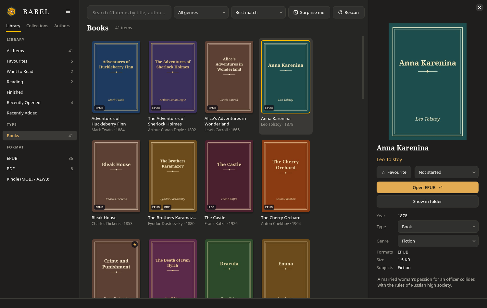
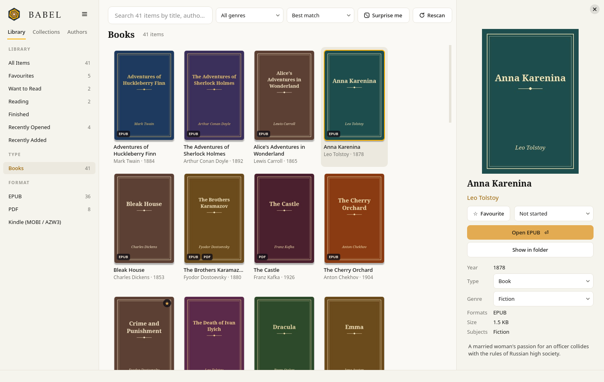
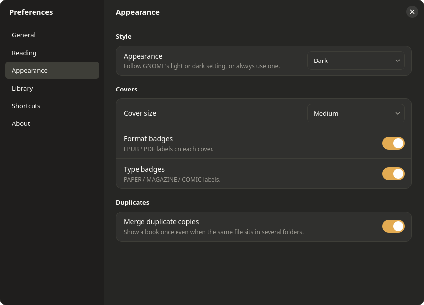

<p align="center"></p>

# Babel

A desktop library for the books you already have. Point Babel at a folder and it
finds every EPUB, PDF, Kindle book and comic inside it, collects their covers, and
lets you browse, search and organise them, without ever moving or changing your files.

Named after Jorge Luis Borges' story *The Library of Babel*.



<details>
<summary>Light mode, and the Preferences window</summary>



<p align="center"></p>
</details>

<sub>Screenshots show a demo library of public-domain classics with stand-in covers.
With your own books, Babel shows each book's real cover.</sub>

## Features

- **Cover grid** of every book, paper, magazine and comic in your books folder, with a
  details panel (description, publisher, year, formats, genre).
- **Fast search** across titles, authors, collections, subjects and descriptions, saying
  when a result only *mentions* what you searched for.
- **Shelves:** favourites, Want to Read, Reading, Finished, Recently Opened, Recently Added.
- **Browse** by type (books, papers, magazines, comics), format, genre, collection or author,
  with format filters inside a collection or author.
- **Genres** from each book's own tags, or from the author's occupation on
  [Wikidata](https://www.wikidata.org) (only author names are sent). Editable per book or
  per author.
- **Understands messy file names**, including folders named "Last, First"; shows them as
  "First Last" and sorts by surname.
- **Duplicates:** shows the same book stored in several folders as one card, and can move
  byte-identical copies to the Trash (after asking).
- **Stays up to date:** watches the folder and picks up new, changed and removed books.
- **Kobo e-readers:** send books over USB (Kindle-only books are converted with Calibre),
  and eject.
- **Opens books** in your chosen reader per format (e.g. Foliate for EPUB, Document Viewer
  for PDF).
- **Light and dark mode**, following GNOME's setting, plus a GNOME-style window.

## Requirements

- Linux (developed on GNOME / Wayland)
- Python 3.10+
- PyQt6 and Pillow (`pip install -r requirements.txt`, or your distro's packages)

Optional helpers, used when installed:

| Tool | Package | Used for |
|---|---|---|
| `pdftoppm` | poppler | PDF covers |
| `bsdtar` | libarchive | comic covers |
| `ebook-meta`, `ebook-convert` | calibre | Kindle covers and Kobo conversion |
| `foliate` | foliate | reading EPUBs |
| `kepubify` | kepubify | Kobo-format EPUBs |
| `udisksctl` | udisks2 | ejecting a Kobo |

## Run

```bash
python3 babel.py
```

On first launch Babel asks for your books folder. Everything else is in
**Preferences** (Ctrl+,).

To add Babel to your app menu:

```bash
python3 babel.py --install
```

`--uninstall` removes it again; your library data is kept.

## Single-file binary

`build.sh` bundles Babel, Python and Qt into one executable (`dist/babel`) with
[PyInstaller](https://pyinstaller.org). It runs on Linux systems at least as new as the
one it was built on. Copy it to another computer and run `./babel --install`.

## Where things are kept

- Library index and covers: `~/.local/share/babel/`
- Settings: `~/.config/Babel/Babel.conf`

Your book files are only ever read. The one exception is the duplicate clean-up, which
moves exact copies to the Trash, and only after you confirm.

## Licence

GPL-3.0-or-later. See [LICENSE](LICENSE).
